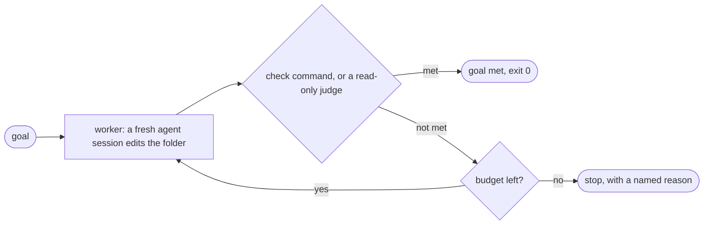

# subgoal

[](LICENSE)


**A coding-agent loop in a few hundred lines of plain Python.** Give it a goal; it calls a
coding agent in a fresh session, checks the result, and repeats until the goal is met or a
budget runs out. Standard library only: no packages to install.

It exists to show the moving parts between a bare `while :; do ...; done` and a full agent
product: a finish line the agent does not get to grade itself, state kept on disk, a fresh
context every call, hard limits, and an honest ending.



Every step is a new session with no memory. What carries over is on disk: the files in the
folder, the worker's own `notes.md`, and the last check output or judge verdict.

## Quick start

You need Python 3.10+ and a coding agent that is logged in: Claude Code (the default) or
[opencode](https://opencode.ai) with `--provider opencode`. There is nothing to install.

Try it on the fizzbuzz example. A run edits files, so it works on a throwaway copy:

```bash
git clone https://github.com/ydmitry/subgoal-skill && cd subgoal-skill
mkdir -p /tmp/fizz && cp examples/fizzbuzz/* /tmp/fizz/
python3 -m subgoal --dir /tmp/fizz --goal-file /tmp/fizz/GOAL.md \
  --check "python3 -m unittest -q test_fizzbuzz" --protect test_fizzbuzz.py
```

The goal is "make the tests pass without editing the test file". After each step the loop
runs your check, and exit 0 means done. A real run, shortened (a small, fast model is plenty:
`--model NAME`):

```text
subgoal: GOAL MET after step 1: the check exited 0
  This proves what the check tests and nothing more. Read the diff.
  goal      Make the tests in test_fizzbuzz.py pass without editing that file.
  check     python3 -m unittest -q test_fizzbuzz      last run after step 1: exit 0
  steps     1 of 5 worker calls
  time      0m 18s of 30m 00s (checks included)
  tokens    174,667 (no limit set; as reported by the provider)
  cost      $0.01 (the provider's own estimate; a subscription is not billed per call)
  worker's last words (unverified): "The goal is met: ..."
  check output (tail):
    Ran 4 tests in 0.000s

    OK
  records   /private/tmp/fizz/.subgoal/20261021-150625/
```

Add `--dry-run` first to see the exact command and the first prompt, with no agent called.

Everything the run did is in that `records` folder: `run.json`, the worker's `notes.md`, and
for each step the exact prompt, the reply, and the check output or the judge's reply.

## Who says "done": a check or a judge

- **`--check CMD`** is a shell command the loop runs after every step. Exit 0 means met.
  Tests make the best checks. Use a check whenever a command can tell.
- **No `--check`** means a judge decides: one more fresh agent session, read-only, that reads
  the files against your goal and ends its reply with `VERDICT: met` or `VERDICT: not met`
  (anything else is not met). Its "met" is a model's opinion, and the report says so.
  Try it on [`examples/write-the-docs`](examples/write-the-docs); `--judge-model NAME` picks its model.
- **`--protect PATH`** names files the worker must not touch, such as the tests. If one
  changes, the run stops before anything is checked.

The worker's own "I'm done" is printed in the report, but never trusted.

## ⚠️ Safety: read before the first real run

- **It runs a coding agent unattended, as you.** The worker edits files in `--dir` and, with a
  check, may run that command too, so in effect it can run any code you can. Work on a
  throwaway copy or a clean git state you can reset. Hooks and MCP servers in that folder run too.
- **Never add `--dangerously-skip-permissions`** outside an isolated container with no
  internet access. The project itself never passes it.
- **Every step spends your Claude subscription usage or API budget.** The limits bound the
  spend; they do not remove it.
- **The judge is read-only, but it does not run your code.** It reads, so it cannot test
  anything, and it can be wrong. "Goal met" proves what the check tests, nothing more. Read the diff.

## Use it as a Claude Code skill

The repo root holds a `SKILL.md`, so a clone in your skills folder is a skill. Name the folder
`subgoal`, like the skill (the Agent Skills format wants the two to match):

```bash
git clone https://github.com/ydmitry/subgoal-skill ~/.claude/skills/subgoal
```

Claude Code then offers `/subgoal`: it turns your request into a goal with a check or done
criteria, shows you the dry run, runs for real in the background once you say yes, and reads
the report at the end. The safety section applies unchanged.

## Writing a good goal

- **One measurable end state.** "The tests in `test_x.py` pass", not "improve the code".
- **A check whenever a command can tell.** Exit 0 is the only road to "met". Put a compound
  check (`make test && make lint`) in a script, and `--protect` the script.
- **Without a check, write done criteria a reader can tick off from the files alone:**
  numbered and observable ("README.md has three sections, in this order"), never "good
  docs". See [`examples/write-the-docs/GOAL.md`](examples/write-the-docs/GOAL.md).
- **Protect the finish line.** `--protect` the tests, the check script, anything that must not change.
- **Stuck in a loop?** Add a sign: one line in the goal that says what not to do.

## Providers

| `--provider` | Runs | Notes |
|---|---|---|
| `claude-code` (default) | `claude -p`, a new session per call | The worker edits files and runs only the check you pass. |
| `opencode` | `opencode run`, a new session per call | The worker may run any shell command in the folder. The judge can only read and run `git status`, `diff`, `log` and `show`. `--allow` is refused. |

Tried with Claude Code 2.1.307 and opencode 1.19.3. Adding another one is small. The whole contract between the loop and an agent is
[`subgoal/provider.py`](subgoal/provider.py): a class with `describe()` and
`run(prompt, workdir, timeout_s)` that starts a fresh session and returns a `Reply`. Register
it in [`subgoal/cli.py`](subgoal/cli.py); the loop does not change. The opencode provider
([`subgoal/opencode.py`](subgoal/opencode.py)) is a good model to copy.

## How a run ends

Every run ends with exactly one named stop reason and an exit code:

| Stop reason | Meaning | Exit code |
|---|---|---|
| `goal_met` | The check exited 0, or the judge said met. | 0 |
| `out_of_iterations` | All N worker calls were made (default 5). | 1 |
| `out_of_time` | The wall-clock limit was reached (default 30 minutes). | 1 |
| `out_of_tokens` | The `--max-tokens` limit was reached. | 1 |
| `provider_failed` | The agent tool was missing, failed, or returned unreadable output. | 3 |
| `protected_file_changed` | The worker changed a `--protect` path. Nothing is checked. | 3 |
| `interrupted` | You pressed Ctrl+C. | 130 |
| (bad arguments) | Usage error. No run folder is created. | 2 |

## Reading the code

A test caps the core's size so it stays readable in one sitting. Read in this order:

| File | What is in it |
|---|---|
| [`subgoal/provider.py`](subgoal/provider.py) | The whole agent contract, about 30 lines. |
| [`subgoal/loop.py`](subgoal/loop.py) | The loop itself: `run_loop()`, the prompt template, the limits, the report. |
| [`subgoal/judge.py`](subgoal/judge.py) | The judge's prompt and the strict parse of its verdict line. |
| [`subgoal/claude_code.py`](subgoal/claude_code.py) | The `claude -p` command line, its read-only variant, and its JSON reply. |
| [`subgoal/opencode.py`](subgoal/opencode.py) | The same for `opencode run`: permissions as one config, JSON events as a reply. |
| [`subgoal/cli.py`](subgoal/cli.py) | The arguments, the provider registry, `--dry-run`. |

Run the tests with `python3 -m unittest discover -s tests`: they need no model. A `FakeProvider`
plays scripted steps, and a fake `opencode` program plays the opencode side. One optional test starts the real opencode against a scripted local
model (never a real one) to show the judge cannot write:
`SUBGOAL_TEST_OPENCODE=/path/to/opencode python3 -m unittest tests/test_opencode_real.py`.
An exercise, if you want one: stop when the check output repeats N times in a row.

## Credits

- Anthropic, [Building effective agents](https://www.anthropic.com/engineering/building-effective-agents)
  and [Effective harnesses for long-running agents](https://www.anthropic.com/engineering/effective-harnesses-for-long-running-agents):
  "include stopping conditions (such as a maximum number of iterations)", and remember that
  "each new session begins with no memory of what came before".
- Simon Willison, [Designing agentic loops](https://simonwillison.net/2025/Sep/30/designing-agentic-loops/):
  the risks of unattended runs, and "If a credential can spend money, set a tight budget limit."
- Geoffrey Huntley, [Ralph](https://ghuntley.com/ralph/): "In its purest form, Ralph is a
  Bash loop". This project is what grows out of that loop.
- Addy Osmani, [Plan-Act-Observe Loop](https://addyosmani.com/agentic-engineering/plan-act-observe/):
  "think about what to do, do it, check the result, repeat".
- Claude Code docs: [/goal](https://code.claude.com/docs/en/goal), where completion "is decided
  by a fresh model rather than the one doing the work" (if you just want this inside Claude
  Code, use `/goal`); [headless mode](https://code.claude.com/docs/en/headless),
  [permission modes](https://code.claude.com/docs/en/permission-modes), [permission rules](https://code.claude.com/docs/en/permissions).

## License

MIT, see [LICENSE](LICENSE).
