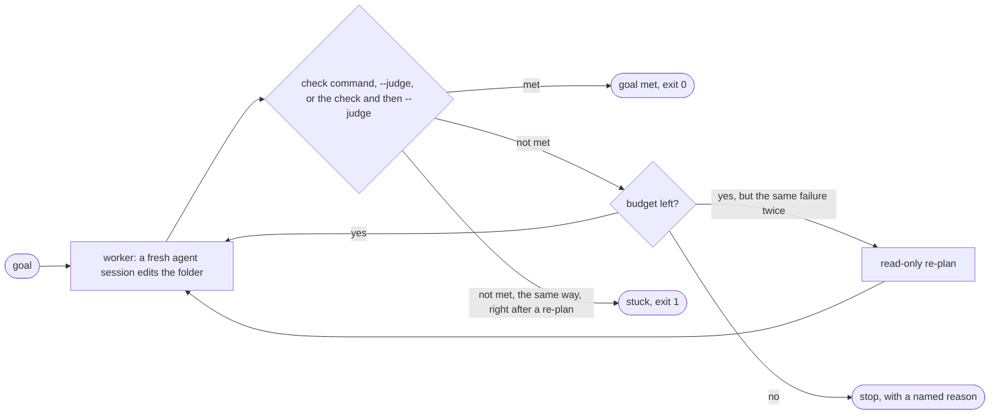

# subgoal

[](LICENSE)


A small example project by one person, not a product.

**A coding-agent loop in a few hundred lines of plain Python.** Give it a goal; it calls a
coding agent in a fresh session, checks the result, and repeats until the goal is met or a
budget runs out. Standard library only: no packages to install.

It exists to show the moving parts between a bare `while :; do ...; done` and a full agent
product: a finish line the agent does not get to grade itself, state kept on disk, a fresh
context every call, hard limits, and an honest ending.

**How it differs**

- **Claude Code's built-in `/goal`** is Claude Code only, and its completion "is decided by a
  fresh model rather than the one doing the work", one that "doesn't run commands or read files
  independently". subgoal runs *your* command as the check, protects files, has hard limits,
  writes every run's records to disk, and drives opencode as well.
- **A bare bash loop** (Ralph) has no check, no budget, no stop reasons and no records.
- **Who it is for:** people who want a bounded, unattended "make this check pass" loop with a
  real check and a hard budget, and people who want to read a small loop to learn how one works.

On names: the repo is `subgoal-skill`; the program and the skill are both called `subgoal`
(`python3 -m subgoal`, `/subgoal`, the folder `~/.claude/skills/subgoal`).



Every step is a new session with no memory. What carries over is on disk: the files in the
folder, the worker's own `notes.md`, the last check output or judge verdict, and the names of the skills
earlier steps invoked (the next step is told to invoke them again; a fresh session knows no skill).

## Quick start

You need Python 3.10+ and a coding agent that is logged in: Claude Code (the default) or
[opencode](https://opencode.ai) (`--provider opencode` for 1.x, `--provider opencode2` for 2).
There is nothing to install.

Try it on the fizzbuzz example. A run edits files, so it works on a throwaway copy:

```bash
git clone https://github.com/ydmitry/subgoal-skill && cd subgoal-skill
mkdir -p /tmp/fizz && cp examples/fizzbuzz/* /tmp/fizz/
python3 -m subgoal --dir /tmp/fizz --goal-file /tmp/fizz/GOAL.md \
  --check "python3 -m unittest -q test_fizzbuzz" --protect test_fizzbuzz.py
```

The goal is "make the tests pass without editing the test file". After each step the loop
runs your check, and exit 0 means done. A real run, shortened (a small, fast model is plenty:
`--model NAME`):

```text
subgoal: GOAL MET after step 1: the check exited 0
  This proves what the check tests and nothing more. Read the diff.
  goal      Make the tests in test_fizzbuzz.py pass without editing that file.
  check     python3 -m unittest -q test_fizzbuzz      last run after step 1: exit 0
  steps     1 of 4 worker calls
  time      0m 18s of 30m 00s (checks included)
  tokens    174,667 (no limit set; as reported by the provider)
  cost      $0.01 (the provider's own estimate; a subscription is not billed per call)
  worker's last words (unverified): "The goal is met: ..."
  check output (tail):
    Ran 4 tests in 0.000s

    OK
  records   /private/tmp/fizz/.subgoal/20261021-150625/
```

The token figure counts everything the agent read, cached input included, and cached input is
cheap: that is why a tiny task shows a big number next to a cost of one cent.

**Why only one step?** The worker is told it may run your check itself, so on a small task it
fixes things inside the step and passes on the first call. In the runs I tried on small tasks
it was always one step. A second step happens when a step ends with the check still failing:
the next fresh session then gets that check's output (the last 4,000 characters) and the
worker's own notes.

Add `--dry-run` first to see the exact commands (the worker's, and the planner's or the judge's) and the first
prompt, with no agent called.

Everything the run did is in that `records` folder: `run.json`, the worker's `notes.md`, and
for each step the exact prompt, the reply, the check output or the judge's reply, and `trace.md`,
the worker's tool calls.

## Who says "done": a check, nobody, a judge, or a check and then a judge

Which to use (my evaluations behind each choice are in the bullets below):
- **A command can tell** (tests, a build, a script): `--check CMD`. With the default provider the worker may then run
  only that command and simple file commands, plus the Claude Code permission rules you add with `--allow`, such as
  `--allow 'Bash(pytest:*)'`.
- **Code with no test to aim at:** no flag (a plan and one step); then run the tests and read the diff yourself. A
  test that a session writes for you needs your reading and approval before a `--check` relies on it.
- **A page or a document:** `--judge` with an Opus judge, and a `--check` first for what a command can tell (for a
  page made with the illustrate skill, its `gates.py`). In my tests on HTML pages with a Haiku worker, the command
  below made 18 of 20 pages correct (no serious error, at most one small one), against 11 with the check alone and
  7 with the check and a Sonnet judge or with no flag, in separate rounds; the Opus judge was $1.17 of its $1.48 a
  page. With no such script, `--judge` alone with the Opus judge made 17 of 20 at $1.70. Documents other than pages
  were not measured. `ILLUSTRATE` is the illustrate skill's folder, and `--allow Bash` lets the worker run any
  command, as in the tests:
  ```
  python3 -m subgoal --dir DIR --goal-file GOAL.md --model claude-haiku-5-5 --judge --judge-model claude-opus-5-5 \
    --check "python3 ILLUSTRATE/scripts/gates.py page.html" --allow Bash --max-iterations 2 --no-plan
  ```
- **Parts no command can tell, or how the work was done** (a goal that names a skill): `--judge`.

- **`--check CMD`** is a shell command the loop runs after every step. Exit 0 means met.
  Tests make the best checks. Use a check whenever a command can tell. This is the only mode that loops
  on something a model cannot talk its way past. The loop also runs it once before step 1: a check that
  already passes then cannot tell done from not done, so the run ends at once as `check_already_passes`
  (exit 2), and the dry run warns about it. Make it fail first, for example with the failing test. (With
  `--judge` too, a check that already passes does not end the run: see below.)
- **The re-plan.** When the check fails the same way after two steps in a row (the same exit code and the same
  last 2,000 characters of output, with timings such as `0.02s`, `12 ms` or `duration_ms: 1.1`, clock times such as
  `12:03:44,843`, dates and addresses such as `0x7f3a` taken out first), the workers are stuck, and another try from the same notes rarely helps. So before the
  next step a read-only session of the judge model (`--judge-model`, else `--model`) re-plans: it gets the plan
  prompt below plus the check, its output, the workers' notes and the last plan, if any. The steps after it get
  that plan (`NN/plan.md` in the records, next to `NN/plan-prompt.md`). A step right after the pre-check never
  counts as a repeat, there is no re-plan after the last step or past a limit, a re-plan that uses up the tokens or
  the time ends the run before the next step, and a failed re-plan call keeps the last plan. `--no-plan` turns it
  off. If the step that got the new plan fails the same way again, the plan did not help and the run ends as
  `stuck` (exit 1) instead of spending the rest of the budget; a failed re-plan call made no new plan, so it
  does not count, and the next time two steps in a row fail the same way it asks again. A second plan needs the
  failure to change first, so with the default 4 worker calls there is at most one; the report counts them. Any number with a time unit counts as a timing, and any clock
  time or date is taken out, so two failures that differ only in one (`took 350ms`, then `took 300ms`) count as
  the same: the price is a re-plan, or a `stuck` stop, that was not needed. When a run ends with the check failing the way it did
  after an earlier step, by the same rule, the report's check line says so: `exit 2, the same failure since the
  pre-check` (or `since step 2`). Since the pre-check, it means no step changed what the check tests: the check
  or the environment is the problem, not the goal (a test file that cannot even be collected, say), and
  `notes.md` says what the worker verified instead. The report quotes the start and the end of the worker's
  last words, where what it did not do or could not verify usually is.
- **No `--check`** (the default) runs a read-only plan and **one** worker step, then ends as
  `unchecked` (exit 0): nothing verified the result, so run the tests and read the diff yourself. The worker is
  told that nothing checks it and to keep testing its own change until it finds no more problems. Why no loop:
  in my tests a loop whose finish line was a model's opinion did not beat this. On five hard bug-fix tasks with
  Haiku, five runs each, a plan plus one call passed the hidden tests in 9 of 25 runs, one plain call in 3, and
  a loop with a Haiku judge in 2: the judge said "met" to most wrong fixes. A tiny sample, not a benchmark.
  A later, larger test found no loop that beat it either. On 13 real bug fixes from open-source Python projects
  (click, urllib3, werkzeug and others), each given only a short issue and no test, each run twice, Haiku passed
  the tests the real fix added (hidden from every session) and the project's other tests in 19 of 26 runs with
  this default, 17 with an Opus judge loop (`--max-iterations 2`, no plan), 17 when a separate session first wrote a
  failing test from the issue and the loop ran `--check` on it, and 16 with that check and then the Opus judge, or
  with an Opus session writing the test. A Sonnet worker passed 20 with the default and 18 with the judge. Each
  loop came within 3 runs of the default with the same worker, under the gap of 4 set before the runs as the bar
  for a difference. With Haiku, the judge loop cost about four times as much ($0.17 against $0.04 a run). In the
  26 runs with the check alone, every written test failed before the fix and passed after it, yet 9 of those runs
  failed the hidden tests (4 of them on two tasks that no run of any kind passed): a test written from a short
  issue has the issue's gaps, and a loop aimed at it stops once it passes. So for code with no tests, use the
  default and read the diff; if a session writes the test, read it against the issue and approve it before a
  `--check` relies on it.
- **`--judge`** loops on a judge instead: one more fresh agent session with no edit tools. It
  reads the files against your goal, may run commands in the folder (your tests, a script,
  `node` or `python`) to check a part, and ends its reply with `VERDICT: met` or
  `VERDICT: not met` (anything else is not met). Its "met" is a model's opinion, and the report
  says so. It has no browser tool, but it tries Playwright or a headless Chrome from the shell for a web page.
  When the work is a document that states facts about the folder's material (a page, a report), it is told to check
  every fact it can, not a sample, and to run each worked example and number the document shows. Its reply lists
  each fact it checked, the general rules the prose states included, as true, false or unsupported with the
  evidence, and ends with the failing parts, which is the part of a long reply the next worker sees. When the goal
  names the document's reader, it also reads the page as that reader: a point the goal asks for that this reader cannot
  follow, for a missing why or how or a term not yet explained, fails.
  With no check, the worker may run any command in the folder too.
  Try it with `--judge` on [`examples/write-the-docs`](examples/write-the-docs); `--judge-model NAME` picks its model
  and `--judge-provider` its tool (see Providers).
  It is useful for checking *how* the work was done (below), less for whether code is correct.
- **`--check` and `--judge` together.** After every step the check runs first, and the judge is asked only once it
  exits 0, so "met" needs both: the check for what a command can tell (the tests, a page's overflow and lint), the
  judge for the rest. A failing check costs no judge call. The next step sees whichever came last: the failing
  check's output, or, once the check passed, the judge's review. A check that already passes before step 1 does not
  end the run, since the judge still tells done from not done; it guards against regressions instead. Two passing
  checks in a row are no repeated failure, so they bring no re-plan. Everything else is as with `--check` alone:
  the worker may run only the check (add `--allow` rules for more), and there is no plan before step 1, only the
  re-plan when the check fails the same way twice. A command check stays the one finish line a model cannot talk
  past: no verdict can carry a failing check.
  In my tests it beat the judge alone, before the change below. On 10 tasks where Haiku explains real material (code, a pull request, a
  dataset, an incident) to a named reader as one HTML page, with the illustrate skill's page checks as the check
  (`python3 .illustrate/scripts/gates.py page.html`), `--allow Bash` so the worker could run any command as it can
  with the judge alone, and in both arms an Opus judge (`--max-iterations 2`, no plan), each run twice: 18 of 20 pages
  were factually correct (no serious error, at most one small one), against 12 of 20 with the judge alone (one-sided
  Fisher p = 0.03), and the pages held 11 wrong or unsupported claims in all, against 25. (One page in each arm
  came from a run that loaded my own Claude Code setup by mistake; without those two, 18 of 19 against 11 of 19.)
  Pages that were also complete and easy to follow went from 5 to 9 of 20, too few to be sure. A run cost about the same, $1.48 a page
  against $1.61. The page checks passed after every step, so they never held a review back. The judge's prompt and
  the worker's tools were the same in both arms; only the worker's prompt differed: it named the check as the
  finish line and, before step 1, showed the check's failing output, which ends with a rule against hiding a problem
  instead of fixing its cause. Separate Opus and Sonnet sessions graded the pages. A small sample, not a benchmark.
  The judge alone now tells its worker the same in its own words ("Fix the cause of what the reviewer names: never
  reword a true sentence, cut evidence or change a true number to clear it."), in place of a line saying it may
  run commands, such as the tests. Run twice more on the same tasks, the judge alone then made 17 of 20 pages
  correct (one-sided Fisher p = 0.08 against 12, so not proven), with 19 wrong or unsupported claims, at $1.70 a
  page; on the code tasks above it left the count unchanged (17 of 26 runs either way, one task better and one
  worse). So for a document or a page, use `--judge`, with a `--check` first for what a command can tell: with it
  the pages still held fewer wrong or unsupported claims (11 against 19) and cost less ($1.48 against $1.70).
  The judge's model matters as much as having one, and every judge in these page tests was Opus. On the same 10
  tasks, again twice each with a Haiku worker, 7 of 20 pages were correct with no flag ($0.81 a page), 11 of 20 with
  the page checks alone ($0.23), and 7 of 20 with the checks and then a Sonnet judge ($0.48), which said "met" to 12
  of its 13 wrong pages. Against the checks and the Opus judge (18 of 20), each of the three was behind by 7 or more
  pages, worse on at least 5 tasks and better on none. The Opus judge is most of the price: $1.17 of the $1.48 a
  page, for 0.88 million of the run's 3.8 million tokens (cache reads included), since an Opus token cost about 12
  times a Haiku token here. With no `--judge-model` the judge is the worker's model: a Haiku judge, tried early on 7
  pages with an older version and no check, made 2 of them correct. These three arms ran later than the Opus ones,
  with the same tasks and graders, on a later subgoal version that changed the judge-alone worker's prompt and the
  trace's file paths. A recheck by another model kept the gap in errors and narrowed the one in correct pages. A
  Sonnet session, not told which arm a page came from, ran the first of the graders' two fact-check passes on the
  pages of the checks with the Opus judge and of the checks alone. It found about a quarter as many wrong or
  unsupported claims on the judged pages (0.26 against 0.95 a page; the Opus first pass found 0.32 against 1.55),
  and by its count 18 of 19 pages were correct against 16 of 20 (the page from the run that loaded my setup left
  out). But its pass misses real errors: on the checks-alone pages it found 4 of 10 errors that it confirmed as real
  when pointed at them, and counting the other 6 brings that arm to 13 of 20.
- **The plan.** With no `--check`, a read-only session of the judge model (`--judge-model`, else `--model`) first
  reads the folder and writes
  a plan to `plan.md` in the records: the parts the goal covers, suspected defects with file and line, the
  cases workers tend to skip (modifier keys, empty or repeated input, a reset from a state with progress,
  real random values), and one way to verify each part. Only the worker gets it; the judge goes by the goal
  and the files. It names no steps and no order. A failed planning call only means no plan; `--no-plan` skips it.
  It costs one extra read-only session per run. With `--check` there is no plan before step 1, only the re-plan
  above, at one read-only session each.
- **A goal that names a skill** ("use the tiny skill to create hello.txt"), with `--judge`, is
  judged on how the work was done, not only on the result. After each step the loop writes the worker's tool calls
  to `NN/trace.md` in the records, one line per call, in order (`Skill tiny`, `Bash ls`,
  `Write hello.txt`, a file path inside `--dir` relative to it, a run of reads as one line naming the files,
  `Read: planning.md, gates.md`), never what a call returned. The worker
  could edit those files, so after every step the loop writes them all back from its own copy. The judge
  reads the skill's `SKILL.md` and that trace: a skill that was never invoked, or a step it
  requires that the trace does not show, is not met. Every provider writes it in Claude Code's tool names where one exists, so
  an opencode worker's `skill`, `shell` or `apply_patch` call reads `Skill`, `Bash` or `Edit` (a patch names its files).
  A trace line is cut at 160 characters and a long trace loses its middle, and the judge is told not to
  count a cut line as proof that a step did not happen. A call the permission layer denied starts with
  `denied: ` (from the `permission_denials` of claude's result event); an opencode call that was denied or erred
  starts with `failed: `. Neither counts as a skill used.
  The line shows the call as the worker made it, cut at 160 characters: for a compound shell command the refused part
  (a `| tail`, a `$?`, a lint command after `;`) is often past the cut, so `denied: Bash <the check>` does not mean the
  check itself was refused; the worker's reply or notes say what was blocked.
- **`--protect PATH`** names files the worker and the judge must not touch, such as the tests.
  If the worker changes one, the run stops before anything is checked; if a command the judge
  runs changes one, the run stops and its verdict does not count. If a command the re-planner ran changes one,
  the run stops before the next step. (A file the check itself leaves there, such as an ApprovalTests
  `.received` file, is seen only after the next worker step, as before.)

The worker's own "I'm done" is printed in the report, but never trusted.

## ⚠️ Safety: read before the first real run

How the worker edits unattended without `--dangerously-skip-permissions`: with the `claude-code`
provider it runs in Claude Code's `acceptEdits` mode with permission prompts disabled, so it can
edit files in the folder, run simple file commands there (`mkdir`, `mv`, `cp` and the like),
and run the check command you pass and your `--allow` rules (with no check, any shell command, and it may read any file, such as its own screenshots).
Anything else is denied rather than asked, so a run cannot hang waiting for an answer. Background tasks are off too
(`CLAUDE_CODE_DISABLE_BACKGROUND_TASKS=1`): a command that outlives Claude Code's 2-minute Bash timeout fails, instead of
holding the session open until a notification turn replaces the worker's reply. The
planner and the judge have no edit tools and may run shell commands in the folder.

- **It runs a coding agent unattended, as you.** The worker edits files in `--dir` and runs
  commands there: with a check, that command and simple file commands (any command with
  opencode), and a re-plan may run any command; with no check, any command, and the planner and the judge run
  commands too. They run as you,
  unsandboxed, in the folder, so in effect they can run any code you can. Work on a clean git
  tree or a branch you can reset.
  Hooks and MCP servers in that folder run too.
- **Never add `--dangerously-skip-permissions`** outside an isolated container with no
  internet access. The project itself never passes it.
- **Every step spends your Claude subscription usage or API budget.** The limits bound the
  spend; they do not remove it.
- **The judge has no edit tool, but a command it runs can still change files.** It is told to
  leave the work as it is (run the tests, not fix them), and the loop checks only the
  `--protect` paths after it, so run on a clean git tree or a branch. Its "met" is a model's opinion and can be wrong.
  A check command is still the strongest finish line, and the only one a model cannot talk its
  way past. A page needs a browser installed on the machine (the judge tries Playwright or Chrome); a timing
  that no command in the project shows is out of the judge's reach: use a `--check` for those.
  "Goal met" proves what the check tests, nothing more. Read the diff.

## Use it as a Claude Code skill

The repo root holds a `SKILL.md`, so a clone in your skills folder is a skill. Name the folder
`subgoal`, like the skill (the Agent Skills format wants the two to match):

```bash
git clone https://github.com/ydmitry/subgoal-skill ~/.claude/skills/subgoal
```

Claude Code then offers `/subgoal`: it turns your request into a goal with a check or done
criteria, shows you the dry run, runs for real in the background once you say yes, and reads
the report at the end. The safety section applies unchanged.

## Writing a good goal

- **One measurable end state.** "The tests in `test_x.py` pass", not "improve the code".
- **A check whenever a command can tell.** Exit 0 is the only road to "met", and the loop
  verifies nothing else: a done criterion left out of the check is checked by no one. Put a
  compound check (`make test && make lint`) in a script, and `--protect` the script. It must fail before
  the run: one that already passes ends it before any step.
- **Without a check, and with `--judge`, write done criteria the judge can tick off from the files or from a
  command it runs:** numbered and observable ("README.md has three sections, in this order",
  "`npm test` passes"), never "good docs". "The page opens in a browser without errors" works if a headless browser is
  installed (the judge tries Playwright or Chrome); without one it needs a check that drives a
  browser. See [`examples/write-the-docs/GOAL.md`](examples/write-the-docs/GOAL.md).
- **Protect the finish line.** `--protect` the tests, the check script, anything that must not change.
- **Stuck in a loop?** Add a sign: one line in the goal that says what not to do.

## Providers

| `--provider` | Runs | Notes |
|---|---|---|
| `claude-code` (default) | `claude -p`, a new session per call | The worker edits files, runs simple file commands, the check you pass and your `--allow` rules, or, with no check, any shell command and any file read. The judge has no edit tools or MCP servers and may run any shell command. |
| `opencode` | `opencode run` (opencode 1.x), a new session per call | The worker may run any shell command in the folder. The judge has no edit tools, may run any shell command, and loads no plugins. `--allow` is refused. |
| `opencode2` | `opencode run --standalone` (opencode 2), a new session and a private server per call | The worker's shell commands may not name an absolute path, `..` or `~`. The judge has no edit tools, may run shell commands under the same rule, and ignores the folder's own opencode config. `--allow` is refused. Token counts can miss the last step. |

`--provider` sets the worker's tool, and `--judge-provider` the judge's and the planner's (default: the same), so
an opencode worker can have a Claude Code judge. `--judge-model` defaults to `--model` only when the two tools are
the same, since a model name belongs to one tool; otherwise the judge's tool uses its own default. An opencode
worker's tool calls go to `NN/trace.md` like Claude Code's (see the skill bullet above).

Works with a recent Claude Code (last tried with 2.1.310), opencode 1.x (1.19.3) and opencode 2 (2.1.4).
For opencode 2 the provider uses `opencode2` if it is on your PATH (its installer adds one), else `opencode`,
and refuses any binary that does not report version 2.
Adding another provider is small: see [CONTRIBUTING.md](CONTRIBUTING.md).

## How a run ends

Every run ends with exactly one named stop reason and an exit code:

| Stop reason | Meaning | Exit code |
|---|---|---|
| `goal_met` | The check exited 0, or the judge said met; with both, the check exited 0 and then the judge said met. | 0 |
| `unchecked` | No `--check` and no `--judge`: one planned step ran and nothing verified it. | 0 |
| `check_already_passes` | The check exited 0 before any step, so it cannot tell done from not done. No step ran. (Not with `--judge`, which then decides.) | 2 |
| `out_of_iterations` | All N worker calls were made (default 4). | 1 |
| `out_of_time` | The wall-clock limit was reached (default 30 minutes). | 1 |
| `out_of_tokens` | The `--max-tokens` limit was reached. | 1 |
| `stuck` | The step that got a re-plan failed the check the same way again: the new plan did not help, so more steps from the same notes would not either. | 1 |
| `provider_failed` | The agent tool was missing, failed, or returned unreadable output. | 3 |
| `protected_file_changed` | The worker changed a `--protect` path (nothing is checked), or a command the judge ran did (its verdict does not count), or a command the re-planner ran did (seen right after it). | 3 |
| `interrupted` | You pressed Ctrl+C, or the loop got SIGTERM (`kill`, a supervisor's timeout); the running agent or check is stopped too. | 130 |
| (bad arguments) | Usage error. No run folder is created. | 2 |

## Reading or changing the code

Start with [CONTRIBUTING.md](CONTRIBUTING.md): the files in reading order, the tests, the size
rule, and how to add a provider.

## Credits

- Anthropic, [Building effective agents](https://www.anthropic.com/engineering/building-effective-agents)
  and [Effective harnesses for long-running agents](https://www.anthropic.com/engineering/effective-harnesses-for-long-running-agents):
  "include stopping conditions (such as a maximum number of iterations)", and remember that
  "each new session begins with no memory of what came before".
- Simon Willison, [Designing agentic loops](https://simonwillison.net/2025/Sep/30/designing-agentic-loops/):
  the risks of unattended runs, and "If a credential can spend money, set a tight budget limit."
- Geoffrey Huntley, [Ralph](https://ghuntley.com/ralph/): "In its purest form, Ralph is a
  Bash loop". This project is what grows out of that loop.
- Addy Osmani, [Plan-Act-Observe Loop](https://addyosmani.com/agentic-engineering/plan-act-observe/):
  "think about what to do, do it, check the result, repeat".
- Claude Code docs: [/goal](https://code.claude.com/docs/en/goal), [headless mode](https://code.claude.com/docs/en/headless),
  [permission modes](https://code.claude.com/docs/en/permission-modes) and [permission rules](https://code.claude.com/docs/en/permissions).

## License

MIT, see [LICENSE](LICENSE).
