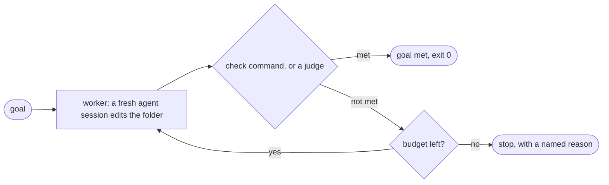

# subgoal

[](LICENSE)


A small example project by one person, not a product.

**A coding-agent loop in a few hundred lines of plain Python.** Give it a goal; it calls a
coding agent in a fresh session, checks the result, and repeats until the goal is met or a
budget runs out. Standard library only: no packages to install.

It exists to show the moving parts between a bare `while :; do ...; done` and a full agent
product: a finish line the agent does not get to grade itself, state kept on disk, a fresh
context every call, hard limits, and an honest ending.

**How it differs**

- **Claude Code's built-in `/goal`** is Claude Code only, and its completion "is decided by a
  fresh model rather than the one doing the work", one that "doesn't run commands or read files
  independently". subgoal runs *your* command as the check, protects files, has hard limits,
  writes every run's records to disk, and drives opencode as well.
- **A bare bash loop** (Ralph) has no check, no budget, no stop reasons and no records.
- **Who it is for:** people who want a bounded, unattended "make this check pass" loop with a
  real check and a hard budget, and people who want to read a small loop to learn how one works.

On names: the repo is `subgoal-skill`; the program and the skill are both called `subgoal`
(`python3 -m subgoal`, `/subgoal`, the folder `~/.claude/skills/subgoal`).



Every step is a new session with no memory. What carries over is on disk: the files in the
folder, the worker's own `notes.md`, and the last check output or judge verdict.

## Quick start

You need Python 3.10+ and a coding agent that is logged in: Claude Code (the default) or
[opencode](https://opencode.ai) (`--provider opencode` for 1.x, `--provider opencode2` for 2).
There is nothing to install.

Try it on the fizzbuzz example. A run edits files, so it works on a throwaway copy:

```bash
git clone https://github.com/ydmitry/subgoal-skill && cd subgoal-skill
mkdir -p /tmp/fizz && cp examples/fizzbuzz/* /tmp/fizz/
python3 -m subgoal --dir /tmp/fizz --goal-file /tmp/fizz/GOAL.md \
  --check "python3 -m unittest -q test_fizzbuzz" --protect test_fizzbuzz.py
```

The goal is "make the tests pass without editing the test file". After each step the loop
runs your check, and exit 0 means done. A real run, shortened (a small, fast model is plenty:
`--model NAME`):

```text
subgoal: GOAL MET after step 1: the check exited 0
  This proves what the check tests and nothing more. Read the diff.
  goal      Make the tests in test_fizzbuzz.py pass without editing that file.
  check     python3 -m unittest -q test_fizzbuzz      last run after step 1: exit 0
  steps     1 of 5 worker calls
  time      0m 18s of 30m 00s (checks included)
  tokens    174,667 (no limit set; as reported by the provider)
  cost      $0.01 (the provider's own estimate; a subscription is not billed per call)
  worker's last words (unverified): "The goal is met: ..."
  check output (tail):
    Ran 4 tests in 0.000s

    OK
  records   /private/tmp/fizz/.subgoal/20261021-150625/
```

The token figure counts everything the agent read, cached input included, and cached input is
cheap: that is why a tiny task shows a big number next to a cost of one cent.

**Why only one step?** The worker is told it may run your check itself, so on a small task it
fixes things inside the step and passes on the first call. In the runs I tried on small tasks
it was always one step. A second step happens when a step ends with the check still failing:
the next fresh session then gets that check's output (the last 4,000 characters) and the
worker's own notes.

Add `--dry-run` first to see the exact command and the first prompt, with no agent called.

Everything the run did is in that `records` folder: `run.json`, the worker's `notes.md`, and
for each step the exact prompt, the reply, and the check output or the judge's reply.

## Who says "done": a check or a judge

- **`--check CMD`** is a shell command the loop runs after every step. Exit 0 means met.
  Tests make the best checks. Use a check whenever a command can tell.
- **No `--check`** means a judge decides: one more fresh agent session with no edit tools. It
  reads the files against your goal, may run commands in the folder (your tests, a script,
  `node` or `python`) to check a part, and ends its reply with `VERDICT: met` or
  `VERDICT: not met` (anything else is not met). Its "met" is a model's opinion, and the report
  says so. It has no browser tool: when everything files and commands can show holds and only
  parts neither can show are left (a page in a browser, a timing), it ends with
  `VERDICT: not met, cannot see: ...`. In this mode the worker may run any command in the folder too.
  Try it on [`examples/write-the-docs`](examples/write-the-docs); `--judge-model NAME` picks its model.
- **`--protect PATH`** names files the worker and the judge must not touch, such as the tests.
  If the worker changes one, the run stops before anything is checked; if a command the judge
  runs changes one, the run stops and its verdict does not count.

The worker's own "I'm done" is printed in the report, but never trusted.

## ⚠️ Safety: read before the first real run

How the worker edits unattended without `--dangerously-skip-permissions`: with the `claude-code`
provider it runs in Claude Code's `acceptEdits` mode with permission prompts disabled, so it can
edit files in the folder, run simple file commands there (`mkdir`, `mv`, `cp` and the like),
and run the check command you pass and your `--allow` rules (with no check, any shell command).
Anything else is denied rather than asked, so a run cannot hang waiting for an answer. The
judge has no edit tools and may run shell commands in the folder.

- **It runs a coding agent unattended, as you.** The worker edits files in `--dir` and runs
  commands there: with a check, that command and simple file commands (any command with
  opencode); with no check, any command, and the judge runs commands too. They run as you,
  unsandboxed, in the folder, so in effect they can run any code you can. Work on a clean git
  tree or a branch you can reset.
  Hooks and MCP servers in that folder run too.
- **Never add `--dangerously-skip-permissions`** outside an isolated container with no
  internet access. The project itself never passes it.
- **Every step spends your Claude subscription usage or API budget.** The limits bound the
  spend; they do not remove it.
- **The judge has no edit tool, but a command it runs can still change files.** It is told to
  leave the work as it is (run the tests, not fix them), and the loop checks only the
  `--protect` paths after it, so run on a clean git tree or a branch. Its "met" is a model's opinion and can be wrong.
  A check command is still the strongest finish line, and the only one a model cannot talk its
  way past. A browser view or a timing that no command in the project shows is out of the
  judge's reach: use a `--check` that drives one.
  "Goal met" proves what the check tests, nothing more. Read the diff.

## Use it as a Claude Code skill

The repo root holds a `SKILL.md`, so a clone in your skills folder is a skill. Name the folder
`subgoal`, like the skill (the Agent Skills format wants the two to match):

```bash
git clone https://github.com/ydmitry/subgoal-skill ~/.claude/skills/subgoal
```

Claude Code then offers `/subgoal`: it turns your request into a goal with a check or done
criteria, shows you the dry run, runs for real in the background once you say yes, and reads
the report at the end. The safety section applies unchanged.

## Writing a good goal

- **One measurable end state.** "The tests in `test_x.py` pass", not "improve the code".
- **A check whenever a command can tell.** Exit 0 is the only road to "met", and the loop
  verifies nothing else: a done criterion left out of the check is checked by no one. Put a
  compound check (`make test && make lint`) in a script, and `--protect` the script.
- **Without a check, write done criteria the judge can tick off from the files or from a
  command it runs:** numbered and observable ("README.md has three sections, in this order",
  "`npm test` passes"), never "good docs", and never "the page opens in a browser without
  errors": the judge has no browser tool, so unless a command in the project shows that, it
  needs a check that drives a browser. If the judge's last review names such parts, the
  report lists them. See
  [`examples/write-the-docs/GOAL.md`](examples/write-the-docs/GOAL.md).
- **Protect the finish line.** `--protect` the tests, the check script, anything that must not change.
- **Stuck in a loop?** Add a sign: one line in the goal that says what not to do.

## Providers

| `--provider` | Runs | Notes |
|---|---|---|
| `claude-code` (default) | `claude -p`, a new session per call | The worker edits files, runs simple file commands, the check you pass and your `--allow` rules, or, with no check, any shell command. The judge has no edit tools or MCP servers and may run any shell command. |
| `opencode` | `opencode run` (opencode 1.x), a new session per call | The worker may run any shell command in the folder. The judge has no edit tools, may run any shell command, and loads no plugins. `--allow` is refused. |
| `opencode2` | `opencode run --standalone` (opencode 2), a new session and a private server per call | The worker's shell commands may not name an absolute path, `..` or `~`. The judge has no edit tools, may run shell commands under the same rule, and ignores the folder's own opencode config. `--allow` is refused. Token counts can miss the last step. |

Works with a recent Claude Code (last tried with 2.1.307), opencode 1.x (1.19.3) and opencode 2 (2.1.4).
For opencode 2 the provider uses `opencode2` if it is on your PATH (its installer adds one), else `opencode`,
and refuses any binary that does not report version 2.
Adding another provider is small: see [CONTRIBUTING.md](CONTRIBUTING.md).

## How a run ends

Every run ends with exactly one named stop reason and an exit code:

| Stop reason | Meaning | Exit code |
|---|---|---|
| `goal_met` | The check exited 0, or the judge said met. | 0 |
| `out_of_iterations` | All N worker calls were made (default 5). | 1 |
| `out_of_time` | The wall-clock limit was reached (default 30 minutes). | 1 |
| `out_of_tokens` | The `--max-tokens` limit was reached. | 1 |
| `provider_failed` | The agent tool was missing, failed, or returned unreadable output. | 3 |
| `protected_file_changed` | The worker changed a `--protect` path (nothing is checked), or a command the judge ran did (its verdict does not count). | 3 |
| `interrupted` | You pressed Ctrl+C. | 130 |
| (bad arguments) | Usage error. No run folder is created. | 2 |

## Reading or changing the code

Start with [CONTRIBUTING.md](CONTRIBUTING.md): the files in reading order, the tests, the size
rule, and how to add a provider.

## Credits

- Anthropic, [Building effective agents](https://www.anthropic.com/engineering/building-effective-agents)
  and [Effective harnesses for long-running agents](https://www.anthropic.com/engineering/effective-harnesses-for-long-running-agents):
  "include stopping conditions (such as a maximum number of iterations)", and remember that
  "each new session begins with no memory of what came before".
- Simon Willison, [Designing agentic loops](https://simonwillison.net/2025/Sep/30/designing-agentic-loops/):
  the risks of unattended runs, and "If a credential can spend money, set a tight budget limit."
- Geoffrey Huntley, [Ralph](https://ghuntley.com/ralph/): "In its purest form, Ralph is a
  Bash loop". This project is what grows out of that loop.
- Addy Osmani, [Plan-Act-Observe Loop](https://addyosmani.com/agentic-engineering/plan-act-observe/):
  "think about what to do, do it, check the result, repeat".
- Claude Code docs: [/goal](https://code.claude.com/docs/en/goal), [headless mode](https://code.claude.com/docs/en/headless),
  [permission modes](https://code.claude.com/docs/en/permission-modes) and [permission rules](https://code.claude.com/docs/en/permissions).

## License

MIT, see [LICENSE](LICENSE).
